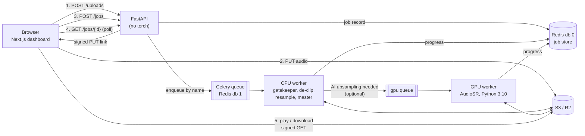

# Audio Gatekeeper

**Checks uploaded audio for damage, repairs what it can, and masters it for streaming.**

A DSP "gatekeeper" measures every upload (clipping, missing high frequencies, dynamics, loudness)
and gives it a 0–100 health score. Healthy tracks skip repair entirely; damaged ones get their
flattened peaks rebuilt and, where the AI model is available, their missing high frequencies
restored. Every track is then mastered to a platform loudness target with a safe true-peak
ceiling and delivered as a 24-bit WAV, with an A/B player to compare before and after.

## Why it matters to a streaming platform

- **Catch damage at ingest, not in listener complaints.** Clipped masters and low-bitrate MP3s
  re-encoded as "lossless" are measurable. The gatekeeper flags them with a reason a person can
  read ("High frequencies are cut off at 11.0 kHz, typical of a low-bitrate MP3").
- **Don't touch what isn't broken.** The decision is per track: in the benchmark, clean files
  bypass every repair step and only get loudness and peak safety.
- **Peak-safe for lossy encoding.** Masters are verified at or below the true-peak ceiling with
  16x oversampling, and independently checked at 32x in the test suite.
- **Honest output.** Every job records what was actually done. If a repair wasn't possible
  (for example, the AI model isn't installed), the UI and the API say so explicitly.

Platforms already normalise loudness at playback, so the core value is the diagnosis and the
rescue. Loudness targets are configurable per platform, and a "keep loudness, fix peaks only"
profile leaves the artist's loudness alone.

## Architecture



Audio never passes through the API: the browser uploads to and plays from the bucket with
short-lived signed links. Details: [docs/ARCHITECTURE.md](docs/ARCHITECTURE.md).

## Measured results

From [docs/BENCHMARKS.md](docs/BENCHMARKS.md): nine synthetic 30-second test files, on an Apple M4 laptop.

- Every non-silent track mastered to **-14.0 LUFS** with a true peak of **-1.19 to -1.20 dBTP**.
- Clipped tracks went from 0.14–0.17% flat-topped samples to **0.000%**. That includes clipping
  that was later turned down, which an absolute 0.99 threshold misses.
- Clean, 16 kHz-cutoff and quiet tracks **bypassed repair**.
- 11 kHz-cutoff tracks were correctly flagged. Without AudioSR they are reported as
  **"partial: highs not restored"**.
- About **20x real time** per track (1.3–1.5 s per 30 s of audio). AudioSR is not included:
  it is not installed in this environment and has not been measured.

## Quick start (local)

Requirements: Python 3.11, Node 22, Redis, and an S3 or R2 bucket.

```bash
# 1. Backend
cd backend
python3.11 -m venv .venv && source .venv/bin/activate
pip install -r requirements-dev.txt
cp .env.example .env                      # set S3_BUCKET, region and credentials
redis-server &                            # or: brew services start redis

uvicorn app.main:app --reload --port 8000
# in a second terminal (same venv):
celery -A app.worker worker --pool=prefork --concurrency=1 --queues=default --loglevel=info

# 2. Frontend
cd ../frontend
cp .env.example .env.local                # NEXT_PUBLIC_API_BASE_URL=http://localhost:8000
npm ci && npm run dev                     # http://localhost:3000
```

The bucket needs a CORS rule so the browser can upload and play: see
[infra/s3-cors.json](infra/s3-cors.json) and [docs/SECURITY_PRIVACY.md](docs/SECURITY_PRIVACY.md#bucket-setup).

**With Docker:** `docker compose up --build`. This is not yet built or tested in CI; see Limitations.

**Tests (no AWS, no Redis server, no GPU needed):**

```bash
cd backend && python -m compileall -q app && pytest -q           # 137 tests
cd frontend && npx tsc --noEmit && npx eslint . && npm test && npm run build
```

## Configuration

All settings are environment variables (or `backend/.env`); defaults are in
[backend/app/config.py](backend/app/config.py), and every option is listed in
[backend/.env.example](backend/.env.example). The most important:

| Setting | Default | What it does |
|---|---|---|
| `S3_BUCKET`, `S3_REGION`, `S3_ENDPOINT_URL` | (required), `us-east-1`, AWS | Where uploads and results live (R2 via `S3_ENDPOINT_URL`) |
| `REDIS_URL` | `redis://localhost:6379/0` | Job store (db 0) and queue (db 1); `rediss://` for TLS |
| `LOUDNESS_PROFILE` | `spotify` | `spotify` (-14 LUFS / -1 dBTP, -2 dBTP if louder than -14), `youtube` (-14, unofficial), `preserve`, `custom` |
| `COMPUTE_DEVICE` | `auto` | `auto`, `cuda`, `mps` or `cpu` |
| `ENABLE_AUDIOSR`, `GPU_QUEUE_ENABLED` | `true`, `false` | AI bandwidth extension, run on a separate GPU worker |
| `MAX_UPLOAD_BYTES`, `MAX_DURATION_SECONDS` | 200 MB, 20 min | Refused before decoding |
| `RATE_LIMIT_PER_MINUTE`, `API_KEY` | 30, unset | Basic abuse protection; see security doc |
| `ENABLE_DOCS` | `true` | `/docs` and `/openapi.json`; switch off in production |

## Project layout

```
backend/app/        API, worker, gatekeeper (dsp_diagnostics), rescue engine (ai_pipeline), storage, job store
backend/tests/      pytest suite: moto (S3) + fakeredis, synthetic signals only
backend/scripts/    manual demo scripts and benchmark.py
frontend/           Next.js 16 dashboard (App Router, CSS modules, no UI dependencies)
docker/, docker-compose.yml, infra/   containers and S3 policies
docs/               architecture, API, benchmarks, security & privacy, demo script
```

## Limitations and roadmap

These are stated plainly, because they matter for an evaluation.

- **AudioSR has not been run or measured here.** It needs CUDA and a separate Python 3.10 image.
  `docker/worker-gpu.Dockerfile` and the `gpu` queue routing are written and unit-tested with a
  fake model, but have not been tested on a GPU. Without it, missing highs are **not restored**,
  and the product says so.
- **AudioSR weights licence is unconfirmed for commercial use.** The model card is empty and a
  downstream copy claims CC-BY-NC. See [THIRD_PARTY_LICENSES.md](THIRD_PARTY_LICENSES.md).
- **De-clipping is a cubic-spline repair.** It reduced the error on clipped tonal peaks by about
  7–14 dB in tests, but made no measurable difference on noise-like transients, and it can't see
  clipping that a lossy codec has smeared.
- **Benchmarks use synthetic signals only.** There is no listening test and no real-music corpus yet.
- **No real authentication.** There is a rate limit, an optional API key and idempotent jobs.
  Job links act as bearer capabilities. OAuth/OIDC and per-tenant quotas are on the roadmap.
- **Docker images are not yet built in CI.** The compose file and Dockerfiles are written but
  were not built in this environment.
- **Roadmap:** a measured GPU path with AudioSR; a real-music evaluation set with blind A/B
  listening; batch ingest from platform storage (no browser); per-tenant auth and quotas;
  metrics and tracing; content-hash de-duplication.

## License

MIT, see [LICENSE](LICENSE). Third-party components: [THIRD_PARTY_LICENSES.md](THIRD_PARTY_LICENSES.md).
