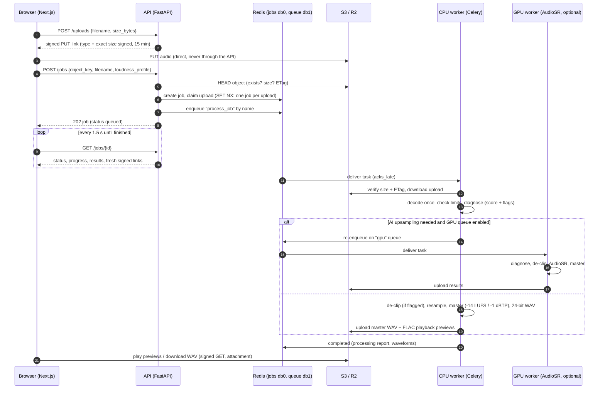

# Architecture

## Request flow



## Components

| Component | Responsibility | Scales by |
|---|---|---|
| **API** (`app/main.py`) | Signs links, creates jobs, reports status. Never touches audio and never imports torch. | Stateless: add replicas behind a load balancer |
| **Job store** (`app/job_store.py`) | One JSON document per job in Redis, with optimistic locking (WATCH/MULTI), a 7-day TTL, and a "finished stays finished" rule | Managed Redis |
| **Queue** (`app/celery_app.py`) | Celery on Redis: `default` and `gpu` queues, `acks_late`, visibility timeout longer than the longest job | Redis, or a broker swap to SQS or RabbitMQ |
| **CPU worker** (`app/worker.py`) | Gatekeeper, de-clip, resample, master, previews. Prefork with one job per process, so time limits are enforced | Horizontal: autoscale on queue depth |
| **GPU worker** (`docker/worker-gpu.Dockerfile`) | AudioSR only, Python 3.10 image, consumes the `gpu` queue | GPU pool sized to the share of flagged tracks |
| **Storage** (`app/storage.py`) | S3 or R2: `uploads/`, `outputs/`. Signed links only. 7-day lifecycle | Object storage |
| **Dashboard** (`frontend/`) | Upload, live progress, report, A/B player | Static plus CDN |

## Job lifecycle and failure handling

```
queued -> downloading -> diagnosing -> [enhancing] -> mastering -> uploading -> completed
   \______________________ any stage _____________________________________/-> failed
```

- **Bad input** (unreadable, too long, too many channels, upload missing or replaced): fails
  at once with a plain message and a machine code. It is not retried.
- **Transient errors** (storage 5xx or throttling, network): up to 2 retries with backoff. The
  status shows "Retrying after a temporary problem", and the retry is queued before the status changes.
- **Permanent storage errors** (access denied, no such bucket): fail at once. The user sees a
  generic message plus a reference code; the full error stays in the server log.
- **Worker crash** (out of memory, killed): the task is redelivered (`acks_late`,
  `reject_on_worker_lost`). After `JOB_MAX_ATTEMPTS` (3) starts, the job is set aside as failed,
  so a "poison" file can't loop forever.
- **Stuck jobs:** `GET /jobs/{id}` marks a job as failed (`stalled`) once it hasn't moved for
  longer than the hard time limit plus 5 minutes.
- **Time limits:** soft 28 min (the job is failed cleanly), hard 30 min (the process is
  killed). This needs the prefork pool; the solo pool ignores time limits.
- **Idempotency:** one upload maps to one job (Redis `SET NX` on the object key). Repeated
  `POST /jobs` calls return the same job. Output keys are per job, so a redelivered job
  overwrites its own results.

## Audio pipeline

1. **Decode once** with libsndfile, after a header check (duration ≤ 20 min, ≤ 2 channels,
   ≤ 192 kHz) so a small compressed file can't expand to many GB of samples.
2. **Gatekeeper:**
   - Clipping: flat-topped runs near the file's own peak.
   - Crest factor.
   - Bandwidth: a *spectral cliff* of 20 dB within 1 kHz above 5 kHz decides; the 85% rolloff
     is reported only.
   - Loudness: BS.1770 via pyloudnorm.
   - The result is a 0–100 score and two flags: `declip` and `upsample`.
3. **De-clip** (if flagged): cubic-spline reconstruction of each flat top, with the boost bounded
   at +6 dB.
4. **Upsample:**
   - If the bandwidth flag is set: AudioSR on a CUDA worker. It runs on the mid channel only and
     adds the new highs to both channels, so the stereo image below the cutoff is untouched.
   - Otherwise, or as the fallback, torchaudio sinc/Kaiser resampling to 48 kHz. In the audit it
     measured flat to 20 kHz (-0.09 dB) with spurious tones at -110 dBc or lower.
5. **Master:** gain to the profile target, then a smoothed true-peak limiter that uses 8x
   oversampling and aims 0.2 dB under the ceiling. The result is re-measured at 16x, with a final
   trim if needed, so output ≤ ceiling holds by construction. If reaching the target would need
   more than 6 dB of limiting, the master is left quieter and the job says so.
6. **Deliver:** 24-bit PCM WAV. Playback uses lossless 24-bit FLAC previews, because browser
   support for AIFF and 24-bit WAV varies.

### Loudness profiles

| Profile | Target | True-peak ceiling | Source |
|---|---|---|---|
| `spotify` | -14 LUFS | -1 dBTP; -2 dBTP if the master is louder than -14 LUFS | [Spotify for Artists: Loudness normalization](https://support.spotify.com/us/artists/article/loudness-normalization/) |
| `youtube` | -14 LUFS | -1 dBTP | **Unofficial:** YouTube publishes no figure. -14 LUFS comes from third-party measurements, for example [Production Advice](https://productionadvice.co.uk/youtube-loudness/) |
| `preserve` | unchanged | -1 dBTP (-2 if louder than -14 LUFS) | Peak safety only |
| `custom` | `TARGET_LUFS` | `TRUE_PEAK_CEILING_DBTP` | Operator setting |

## Scaling plan for platform volume

**Ingest path.** For a platform, the browser flow becomes a server-to-server step. The platform
writes the master to its own bucket and calls the API with an object reference and an API key
or signed token. Results go to an `outputs/` prefix, or a webhook replaces polling.

**Queues and pools:**
- The `default` queue is CPU-only. Autoscale workers on queue length, for example with KEDA's
  Redis-list scaler, using one job per worker process and container limits sized to the longest
  allowed track.
- The `gpu` queue receives only tracks the gatekeeper flags for AI upsampling, so the GPU pool
  can be sized to that fraction. Measure the fraction on real ingest data. It can scale to zero
  between bursts if a cold start is acceptable, because the model loads once per process.

**Capacity, worked example.** Measured: one worker process handled 30 s of audio in 1.3 s on
an Apple M4. For a 3.5-minute track that extrapolates linearly to about 9 s. **Assume** a cloud
vCPU worker runs at half that speed, about 18 s per track; this has to be measured on the real
instance type. At 100,000 uploads a day (about 1.2 per second, evenly spread), roughly
1.2 × 18 = **about 21 busy workers** are needed, plus headroom for peaks.

### Cost per track: estimate with stated assumptions

These are **estimates, not measurements.** Replace each assumption with your own prices and
measured timings.

| Item | Assumption | Per 3.5-minute track |
|---|---|---|
| CPU compute | 18 s per track (above); a 4-vCPU instance at **$0.15/hour (assumed price)** running one job | about $0.0008 |
| Storage | about 150 MB kept for 7 days. That's the upload (8–37 MB), the 24-bit master (about 60 MB) and two FLAC previews (about 60 MB, assuming 55% FLAC compression). **$0.023 per GB-month (assumed S3 Standard price)** | about $0.0008 |
| Egress | One preview playback plus one master download, about 125 MB, at **$0.09/GB (assumed S3 egress price)** | about $0.011 |
| GPU (AudioSR) | **Not measured.** Cost = (GPU seconds per track ÷ 3600) × GPU hourly price × share of flagged tracks | measure before quoting |

So egress, not compute, dominates the CPU path. Serving playback from storage with free or
cheap egress (Cloudflare R2 advertises no egress fees; verify the current terms), or skipping
the previews for server-to-server use, changes the picture more than faster DSP would.

## Observability: present and missing

- **Present:**
  - Structured log lines per job, with job ID and error reference code.
  - `/health`: Redis and queue status, plus S3 with `?full=true`.
  - Job state and timings stored with every job.
- **Missing for production:**
  - Metrics, such as Prometheus counters and histograms for stage durations, outcomes, retries
    and queue depth.
  - Tracing across the API and the worker.
  - Alerting on stalled or failed job rates.
